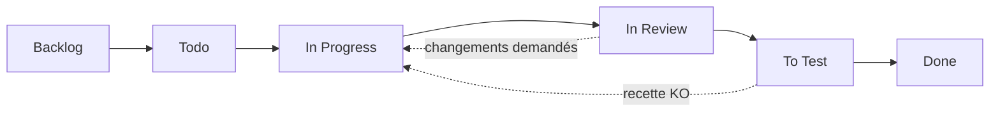

# 📍 LocalLoop

Réseau social de quartier : on suit son quartier, on y publie et on y découvre la vie locale. Frontend **React 18 + Vite**, API **Next.js 14**, base **PostgreSQL 16** via Prisma.

📋 **Backlog :** [GitHub Project](https://github.com/users/Miisterone/projects/5) · 📖 **Doc publiée :** [Storybook et Swagger](https://miisterone.github.io/Gestion-de-projet/)

## 🎯 Contexte

Projet de groupe. Les tickets sont des **issues** du dépôt, suivies dans le GitHub Project :

- une EPIC est une issue avec le label `epic`, ses tâches front et back sont des sous-issues ;
- chaque issue a un identifiant `LL-<id>` dans son titre ;
- le champ **Sprint** range les issues par sprint, les dépendances sont des liens *Blocked by*.

| Rôle | Responsabilité |
|---|---|
| **Product Owner** | Rédige et priorise le backlog, valide les tickets |
| **Dev Back** | API Next.js, base de données, sécurité |
| **Dev Front** | Interface React, intégration de l'API |

## ✨ Fonctionnalités

| EPIC | Disponible | Priorité |
|---|---|:-:|
| 🔐 Authentification | Inscription avec choix du quartier, connexion (JWT) | P0 |
| 📰 Fil d'actualité | Publier, fil paginé, supprimer, signaler une publication | P0 |
| 👤 Profil | Page profil, édition, avatar (URL), statistiques, recherche d'utilisateurs | P1 |
| 👍 Interactions | Likes, commentaires | P1 |
| 📅 Événements | Créer un événement dans son quartier, liste des événements à venir | P1 |
| 🔔 Notifications | Reportées en V2 | V2 |

## 🚀 Installation

Prérequis : Node.js 22 (≥ 20), npm ≥ 10, Docker (ou PostgreSQL 16 en local).

```bash
git clone https://github.com/Miisterone/Gestion-de-projet.git
cd Gestion-de-projet
npm install
cp frontend/.env.example frontend/.env
cp backend/.env.example backend/.env
docker compose up -d db
docker compose exec db createdb -U localloop localloop_test   # base des tests
docker compose exec db createdb -U localloop localloop_e2e    # base des tests E2E
npm run db:migrate -w backend
npm run db:seed -w backend      # comptes de démo, mot de passe : localloop
npm run dev
```

| Service | URL |
|---|---|
| Frontend | http://localhost:5173 |
| API (santé) | http://localhost:3001/api/health → `{ "status": "ok" }` |
| Swagger | http://localhost:3001/api/docs |

**Tout en Docker (mode production) :**

```bash
echo "JWT_SECRET=$(openssl rand -hex 32)" > .env
docker compose up -d --build    # les migrations sont appliquées au démarrage du back
```

### Commandes

| Commande | Rôle |
|---|---|
| `npm run dev` | Front + back en mode dev |
| `npm test` | Tests unitaires et d'intégration (Vitest) |
| `npm run test:e2e` | Tests E2E Playwright en 800×600 |
| `npm run storybook -w frontend` | Storybook sur http://localhost:6006 |
| `npm run docs` | Régénère [docs/API.md](docs/API.md) |
| `npm run db:migrate -w backend` | Applique les migrations |
| `npm run db:migrate:dev -w backend -- --name <nom>` | Crée une migration |
| `npm run db:seed -w backend` | Données de démonstration |
| `npm run db:studio -w backend` | Prisma Studio |

⚠️ Les bases `localloop_test` (`TEST_DATABASE_URL`) et `localloop_e2e` (`E2E_DATABASE_URL`) sont vidées par les tests : ne jamais y pointer la base de développement.

### Structure

```text
frontend/   React + Vite (servi par nginx en production)
backend/    Next.js : routes dans app/api/, schéma Prisma dans prisma/
e2e/        Tests Playwright
docs/       Personas, API, base de données
scripts/    Génération de docs/API.md
.github/    Workflows, modèles d'issue et de PR
```

## 🔄 Workflow des tickets



| Statut | Qui | Déclencheur |
|---|---|---|
| **Backlog** | PO | Issue créée (ajoutée au Project automatiquement 🤖) |
| **Todo** | Équipe | Choisie en sprint planning, si elle respecte la [Definition of Ready](CONTRIBUTING.md#-sprint) |
| **In Progress** | Dev | Branche `feature/<n>-<desc>` créée |
| **In Review** | 🤖 | PR ouverte vers `develop` |
| **To Test** | 🤖 | PR fusionnée, recette par le PO |
| **Done** | 🤖 | Issue fermée |

Branches, commits et PR : voir **[CONTRIBUTING.md](CONTRIBUTING.md)**.

## 🤖 Automatisations

| Workflow | Quand | Ce qu'il fait |
|---|---|---|
| [CI](.github/workflows/ci.yml) | PR, push sur `main` / `develop` | Doc de l'API et catalogue d'erreurs à jour, tests Vitest, build Storybook, tests E2E |
| [PR check](.github/workflows/pr-check.yml) | PR ouverte ou modifiée | Vérifie le nom de branche et le titre, ajoute les labels `frontend` / `backend` / `infra` / `documentation` |
| [Project](.github/workflows/project.yml) | Issue créée, PR ouverte / fusionnée | Ajoute l'issue au Project, met à jour son statut grâce au numéro dans la branche |
| [Docker](.github/workflows/docker.yml) | Push sur `main` / `develop`, tag `v*` | Publie les images sur GHCR : `recette` pour `develop`, `latest` pour `main`, version pour les tags |
| [Docs site](.github/workflows/docs-site.yml) | Push sur `develop` | Publie Storybook et Swagger sur GitHub Pages |
| [Release](.github/workflows/release.yml) | Tag `v*` | Release GitHub avec les PR classées par label |
| [Dependabot](.github/dependabot.yml) | Chaque semaine | PR de mise à jour des dépendances |

Les runs de CI d'une branche sont annulés quand un nouveau commit est poussé, et les builds Docker utilisent un cache.

<details>
<summary>Configuration du Project (une seule fois)</summary>

1. Créer un token *classic* avec les scopes `repo` et `project`, puis l'ajouter en secret Actions sous le nom `PROJECT_TOKEN`.
2. Dans le Project, le champ **Status** doit avoir les options `Backlog`, `Todo`, `In Progress`, `In Review`, `To Test`, `Done` (noms exacts, utilisés par le workflow *Project*).
3. Activer le workflow intégré *Item closed → Done*.

Le nom du champ se change en haut de [project-status.mjs](.github/scripts/project-status.mjs).
</details>

## 📚 Documentation

| Document | Contenu |
|---|---|
| [CONTRIBUTING.md](CONTRIBUTING.md) | Branches, commits, PR, versions, Swagger, Storybook |
| [ERRORS.md](ERRORS.md) | Format des erreurs de l'API et catalogue des codes |
| [docs/API.md](docs/API.md) | Liste des routes (générée) |
| [docs/DATABASE.md](docs/DATABASE.md) | Schéma, dictionnaire des données, migrations |
| [docs/PERSONAS.md](docs/PERSONAS.md) | Les 4 personas et les labels `persona:*` |
