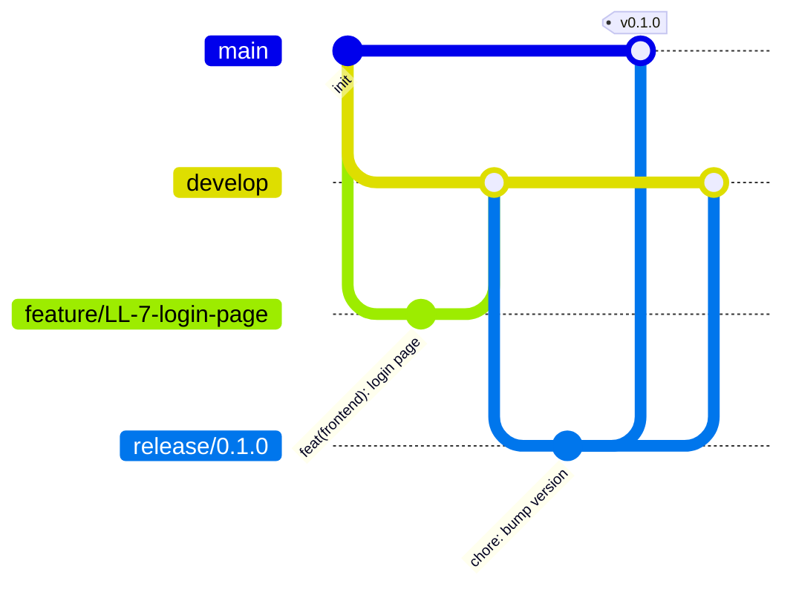
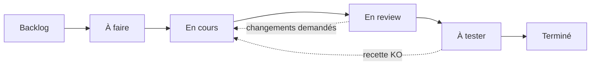

# 📍 LocalLoop

Réseau social de quartier : on suit son quartier, on y publie et on y découvre la vie locale. **React** (frontend) + **Next.js** (API backend).


📋 **Backlog :** [GitHub Project](https://github.com/users/Miisterone/projects/5)

## Sommaire

- [Contexte](#-contexte)
- [Fonctionnalités](#-fonctionnalités)
- [Installation](#-installation)
- [Branching strategy](#-branching-strategy)
- [Workflow des tickets](#-workflow-des-tickets)
- [Automatisations](#-automatisations)
- [Documentation](#-documentation)

---

## 🎯 Contexte

Projet de groupe : concevoir **LocalLoop**, un réseau social local centré sur le quartier (compte, quartier, fil local, publications, interactions, événements). Les identifiants de tickets `LL-<id>` viennent du nom LocalLoop.

| Rôle | Responsabilité |
|---|---|
| **Product Owner** | Rédige et priorise le backlog (GitHub Project), valide les tickets |
| **Dev Back** | API Next.js, base de données, sécurité |
| **Dev Front** | Interface React, intégration de l'API |

La gestion de projet se fait sur **[GitHub Projects](https://github.com/users/Miisterone/projects/5)** : chaque ticket est une **issue** du dépôt. Une EPIC est une issue (label `epic`) dont les tâches front et back sont des **sous-issues**. Chaque issue a un identifiant **`LL-<id>`** dans son titre, repris dans le nom des branches. Le champ **Sprint** du Project range les issues par sprint, les dépendances sont des liens *Blocked by* entre issues.

Colonnes du board (champ **Status**) : **Backlog → À faire → En cours → En review → À tester → Terminé**.

## ✨ Fonctionnalités

| EPIC | Contenu | Priorité |
|---|---|:-:|
| 🔐 Authentification | Inscription, connexion (JWT), déconnexion | P0 |
| 📰 Fil d'actualité | Publier, fil paginé, supprimer | P0 |
| 👤 Profil | Page profil, édition, avatar | P1 |
| 👍 Interactions | Likes, commentaires | P1 |
| 📅 Événements | Créer un événement local, y participer | P1 |
| 🔔 Notifications | Reportées en V2 | V2 |

Le découpage en releases est détaillé dans la [story map](docs/STORYMAP.md).

## 🚀 Installation

### Prérequis

| Outil | Version | Vérification |
|---|---|---|
| Node.js | ≥ 20 (22 recommandé, cf. `.nvmrc`) | `node -v` |
| npm | ≥ 10 | `npm -v` |
| Git | ≥ 2.30 | `git --version` |
| PostgreSQL | 16 (ou Docker) | `psql --version` |

### Lancer avec Docker (le plus simple)

```bash
git clone https://github.com/Miisterone/Gestion-de-projet.git
cd Gestion-de-projet
echo "JWT_SECRET=$(openssl rand -hex 32)" > .env   # secret obligatoire, jamais la valeur par défaut
docker compose up -d --build
```

### Lancer le projet

```bash
git clone https://github.com/Miisterone/Gestion-de-projet.git
cd Gestion-de-projet
git checkout develop
nvm use                                    # optionnel : utilise la version de .nvmrc
npm install                                # installe front + back
cp frontend/.env.example frontend/.env
cp backend/.env.example backend/.env
docker compose up -d db                    # PostgreSQL (ou une instance locale, cf. DATABASE_URL)
docker compose exec db createdb -U localloop localloop_test   # base des tests
docker compose exec db createdb -U localloop localloop_e2e    # base des tests E2E
npm run db:migrate -w backend              # crée les tables
npm run db:seed -w backend                 # comptes de démo (mot de passe : localloop)
npm run dev                                # lance front + back
```

### Vérifier que tout fonctionne

| Service | URL | Résultat attendu |
|---|---|---|
| Frontend | http://localhost:5173 | Page d'accueil |
| Backend | http://localhost:3001/api/health | `{ "status": "ok" }` |
| Swagger | http://localhost:3001/api/docs | Documentation interactive de l'API |

### Commandes

| Commande | Rôle |
|---|---|
| `npm run dev` | Lance front + back en mode dev |
| `npm run docs` | Régénère la doc de l'API ([docs/API.md](docs/API.md)) |
| `npm test` | Tests unitaires et d'intégration (Vitest, back puis front) |
| `npm run storybook -w frontend` | Catalogue des composants sur http://localhost:6006 (viewport 800×600 par défaut) |
| `npm run test:e2e` | Tests E2E Playwright en 800×600 (lance front et back) |
| `npm run db:migrate -w backend` | Applique les migrations PostgreSQL (`prisma migrate deploy`) |
| `npm run db:migrate:dev -w backend -- --name <nom>` | Crée une migration après modification de `schema.prisma` |
| `npm run db:studio -w backend` | Ouvre Prisma Studio pour consulter les données |
| `npm run db:seed -w backend` | Ajoute les données de démonstration |

Les tests d'intégration du back utilisent la base `localloop_test` (variable `TEST_DATABASE_URL`) et les tests E2E la base `localloop_e2e` (`E2E_DATABASE_URL`) : les deux sont vidées pendant les tests, ne jamais y mettre la base de développement.

Le schéma et l'ORM (Prisma) sont décrits dans [docs/DATABASE.md](docs/DATABASE.md).

### Structure

```text
Gestion-de-projet/
├── frontend/   # React + Vite (servi par nginx en production)
├── backend/    # Next.js (routes API dans app/api/, schéma Prisma dans prisma/)
├── docs/       # Personas, story map, doc de l'API…
├── scripts/    # Génération de la doc de l'API
└── .github/    # CI/CD et automations
```

## 🌿 Branching strategy

Nous suivons **GitFlow** : deux branches permanentes (`main`, `develop`) et des branches courtes, une par issue.

| Branche | Rôle | Créée depuis | Fusionnée vers |
|---|---|---|---|
| `main` | Versions stables livrées, taguées | — | — |
| `develop` | Intégration des fonctionnalités du sprint | `main` | — |
| `feature/LL-<id>-<desc>` | Une fonctionnalité = une issue | `develop` | `develop` |
| `fix/LL-<id>-<desc>` | Correction pendant le développement | `develop` | `develop` |
| `release/x.y.z` | Stabilisation d'une version | `develop` | `main` + `develop` |
| `hotfix/LL-<id>-<desc>` | Correctif urgent en production | `main` | `main` + `develop` |



**Règles essentielles :**

- Pas de push direct sur `main` ni `develop` : **Pull Request + 1 review + CI verte** obligatoires.
- Commits au format [Conventional Commits](https://www.conventionalcommits.org/en/v1.0.0/), **en anglais** : `feat(frontend): add profile page`.
- Versions en **Semantic Versioning** `MAJEUR.MINEUR.CORRECTIF` (ex. `v1.2.0`).

👉 Toutes les conventions détaillées sont dans **[CONTRIBUTING.md](CONTRIBUTING.md)**.

## 🔄 Workflow des tickets



| Statut | Qui | Action |
|---|---|---|
| **Backlog** | PO | Crée le ticket, le rattache à son EPIC |
| **À faire** | Équipe | Ticket choisi en sprint planning |
| **En cours** | Dev | Crée sa branche `feature/LL-<id>-<desc>` |
| **En review** | Dev | Ouvre la PR vers `develop` 🤖 |
| **À tester** | PO | PR fusionnée, le PO vérifie 🤖 |
| **Terminé** | PO | Validé |

🤖 = statut mis à jour automatiquement par GitHub Actions.

## 🤖 Automatisations

Toutes les automatisations sont des workflows GitHub Actions dans [.github/workflows/](.github/workflows/).

| Workflow | Quand | Ce qu'il fait |
|---|---|---|
| [CI](.github/workflows/ci.yml) | Chaque PR et push sur `main` / `develop` | Vérifie que la doc de l'API est à jour |
| [PR check](.github/workflows/pr-check.yml) | Ouverture / modification d'une PR | Vérifie le nom de la branche et le titre (Conventional Commits), ajoute les labels `frontend` / `backend` / `infra` / `documentation` |
| [Project](.github/workflows/project.yml) | Issue créée, PR ouverte / mergée | Ajoute l'issue au Project, puis passe l'issue `LL-<id>` de la branche en **En review** puis **À tester** |
| [Docker](.github/workflows/docker.yml) | Push sur `main` / `develop` ou tag `v*` | Build les images front et back et les publie sur GitHub Container Registry (tag `recette` et environnement GitHub *recette* sur `develop`) |
| [Release](.github/workflows/release.yml) | Tag `v*` | Crée la release GitHub avec la liste des PR, classées par label |
| [Dependabot](.github/dependabot.yml) | Chaque semaine | Ouvre des PR pour mettre à jour les dépendances |

**Performances de la CI :** cache Docker entre les builds, et annulation du run précédent quand un nouveau commit est poussé sur la même branche.

**Orchestration ([docker-compose.yml](docker-compose.yml)) :** un conteneur par service, en mode production.

- Le back attend d'être *healthy* (healthcheck sur `/api/health`) avant que le front démarre.
- Redémarrage automatique en cas de crash, limites de CPU et de mémoire.
- Le front est servi par nginx avec compression gzip et cache long sur les fichiers JS / CSS.
- Les données sont gardées dans un volume Docker.

**Documentation automatique :** `npm run docs` lit les routes de `backend/app/api` et génère [docs/API.md](docs/API.md). La CI échoue si la doc n'a pas été régénérée après un changement d'API. Les notes de version sont générées à chaque release.

**Configuration GitHub Project** (une seule fois) : créer un token *classic* avec les scopes `repo` et `project`, l'ajouter dans *Settings → Secrets and variables → Actions* sous le nom `PROJECT_TOKEN`. Dans le Project, le champ **Status** doit contenir les options `Backlog`, `À faire`, `En cours`, `En review`, `À tester`, `Terminé` ; activer aussi le workflow intégré *Item closed → Terminé*. Le nom du champ est modifiable en haut de [project-status.mjs](.github/scripts/project-status.mjs).

## 📚 Documentation

| Document | Contenu |
|---|---|
| [CONTRIBUTING.md](CONTRIBUTING.md) | Branches, commits, Pull Requests, versions |
| [docs/PERSONAS.md](docs/PERSONAS.md) | Nos 4 personas, leurs besoins et les labels `persona:*` |
| [docs/STORYMAP.md](docs/STORYMAP.md) | Parcours utilisateur et découpage en releases |
| [docs/API.md](docs/API.md) | Routes de l'API (générée automatiquement) |
| [Doc publiée](https://miisterone.github.io/Gestion-de-projet/) | Storybook et Swagger de `develop`, publiés par la CI (workflow *Docs site*) sur GitHub Pages |
| [Swagger](http://localhost:3001/api/docs) | Doc interactive de l'API (`/api/docs`, document brut sur `/api/openapi.json`) |
| [ERRORS.md](ERRORS.md) | Format des erreurs de l'API et catalogue des codes |
| [docs/DATABASE.md](docs/DATABASE.md) | Schéma de la base, dictionnaire des données, migrations |
