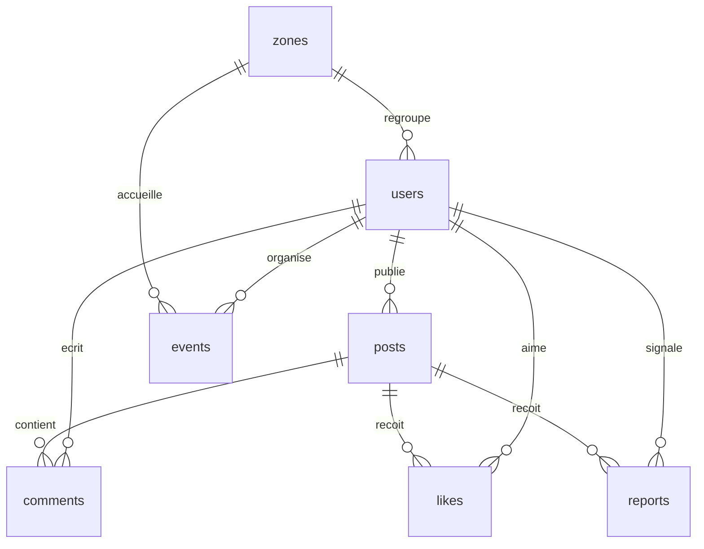

# Base de données

PostgreSQL 16, schéma décrit dans [`backend/prisma/schema.prisma`](../backend/prisma/schema.prisma) et versionné dans [`backend/prisma/migrations`](../backend/prisma/migrations).

## ORM : Prisma

L'accès à la base passe par **Prisma 7** (`@prisma/client` avec l'adaptateur `@prisma/adapter-pg`) :

| Élément | Où |
|---|---|
| Schéma (modèles, relations, contraintes) | `backend/prisma/schema.prisma` |
| Configuration (URL de la base, dossier des migrations, seed) | `backend/prisma.config.js` |
| Migrations SQL versionnées | `backend/prisma/migrations` |
| Client partagé par les routes | `backend/lib/prisma.js` (`import { prisma } from '@/lib/prisma'`) |
| Données de démonstration | `backend/prisma/seed.js` |

Conventions de nommage : modèles en anglais et en camelCase dans le code (`User.firstName`), snake_case dans la base (`users.first_name`, via `@map` / `@@map`).

Le client est régénéré par `npm install` (`postinstall`). Si le schéma change sans réinstallation, lancer `npx prisma generate` dans `backend/`.

## Modèle conceptuel

## Dictionnaire des données

### zones

| Colonne | Type | Contraintes | Description |
|---|---|---|---|
| id | serial | PK | Identifiant |
| name | text | non nul | Nom du quartier |
| city | text | non nul | Ville |

Unicité sur (name, city). La zone pilote (5 quartiers de Toulouse) est insérée par la migration `pilot_zones` : ce sont des données de référence, présentes dans tous les environnements.

### users

| Colonne | Type | Contraintes | Description |
|---|---|---|---|
| id | uuid | PK, généré | Identifiant |
| first_name | text | non nul | Prénom |
| last_name | text | non nul | Nom |
| email | text | non nul, unique | Email en minuscules |
| password | text | non nul | Hash bcrypt, jamais renvoyé par l'API |
| bio | text | non nul, défaut `''` | Présentation |
| avatar | text | non nul, défaut `''` | URL de l'avatar |
| zone_id | integer | FK zones, restrict, nullable | Quartier choisi à l'inscription (obligatoire à l'inscription, null pour les comptes plus anciens) |
| created_at | timestamptz | non nul, défaut `now()` | Date d'inscription |

Aucune adresse n'est stockée (RGPD, persona Chloé) : seul le quartier est connu, et c'est la seule information de localisation visible sur un profil.

### posts

| Colonne | Type | Contraintes | Description |
|---|---|---|---|
| id | uuid | PK | Identifiant |
| author_id | uuid | FK users, cascade, indexé | Auteur |
| content | text | non nul | Texte de la publication |
| created_at | timestamptz | non nul, indexé | Date de publication |

### comments

| Colonne | Type | Contraintes | Description |
|---|---|---|---|
| id | uuid | PK | Identifiant |
| post_id | uuid | FK posts, cascade, indexé | Publication commentée |
| author_id | uuid | FK users, cascade | Auteur |
| content | text | non nul | Texte |
| created_at | timestamptz | non nul | Date |

### likes

| Colonne | Type | Contraintes | Description |
|---|---|---|---|
| post_id | uuid | PK (avec user_id), FK posts, cascade | Publication |
| user_id | uuid | PK (avec post_id), FK users, cascade | Utilisateur |
| created_at | timestamptz | non nul | Date |

La clé primaire composée garantit un seul like par utilisateur et par publication.

### events

| Colonne | Type | Contraintes | Description |
|---|---|---|---|
| id | uuid | PK | Identifiant |
| author_id | uuid | FK users, cascade | Organisateur |
| zone_id | integer | FK zones, restrict | Quartier de l'événement : celui de l'auteur à la création, jamais choisi par le client |
| title | text | non nul | Titre (100 caractères max., contrôlé par l'API) |
| description | text | non nul | Description (1000 caractères max.) |
| place | text | non nul | Lieu de rendez-vous en texte libre (« Place du Salin »), jamais une adresse personnelle |
| starts_at | timestamptz | non nul | Date et heure de début, dans le futur à la création |
| created_at | timestamptz | non nul, défaut `now()` | Date de création |

Index sur (zone_id, starts_at) : la liste d'un quartier ne montre que les événements à venir, du plus proche au plus lointain.

### reports

| Colonne | Type | Contraintes | Description |
|---|---|---|---|
| id | uuid | PK | Identifiant |
| post_id | uuid | FK posts, cascade | Publication signalée |
| reporter_id | uuid | FK users, cascade, indexé | Utilisateur qui signale |
| reason | report_reason | non nul | Motif : `abus`, `inapproprie`, `erronee` ou `autre` |
| created_at | timestamptz | non nul, défaut `now()` | Date du signalement |

Unicité sur (post_id, reporter_id) : un utilisateur ne signale qu'une fois la même publication (`LL_REPORT_409` sinon). Le traitement des signalements (statut, rôle modérateur) arrive avec la modération (LL-225).

## Modifier le schéma

1. Modifier `backend/prisma/schema.prisma`.
2. Créer et appliquer la migration sur la base de développement : `npm run db:migrate:dev -w backend -- --name <description>` (le client Prisma est régénéré au passage).
3. Relire le fichier `migration.sql` créé dans `backend/prisma/migrations`.
4. Commiter le schéma **et** la migration dans le même commit (`feat(database): ...`).

Ailleurs (CI, conteneur, bases de test), les migrations sont appliquées par `prisma migrate deploy`, qui n'en crée jamais. Une migration fusionnée dans `develop` ne se modifie plus : on en crée une nouvelle.
